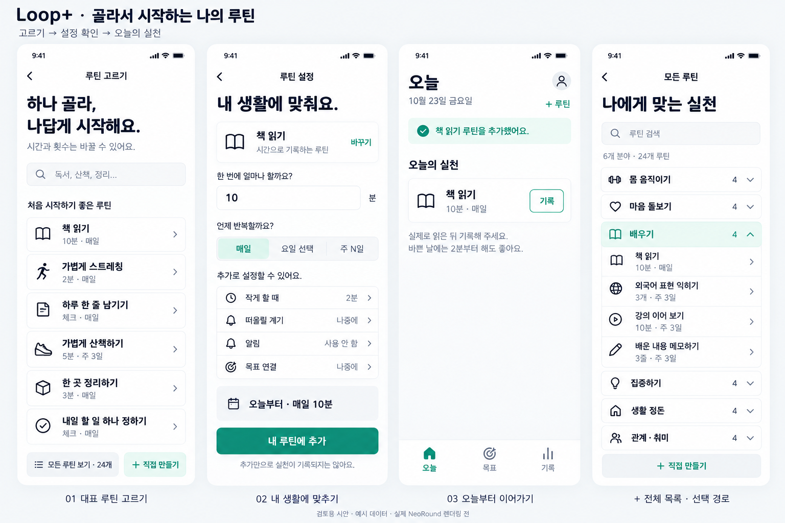
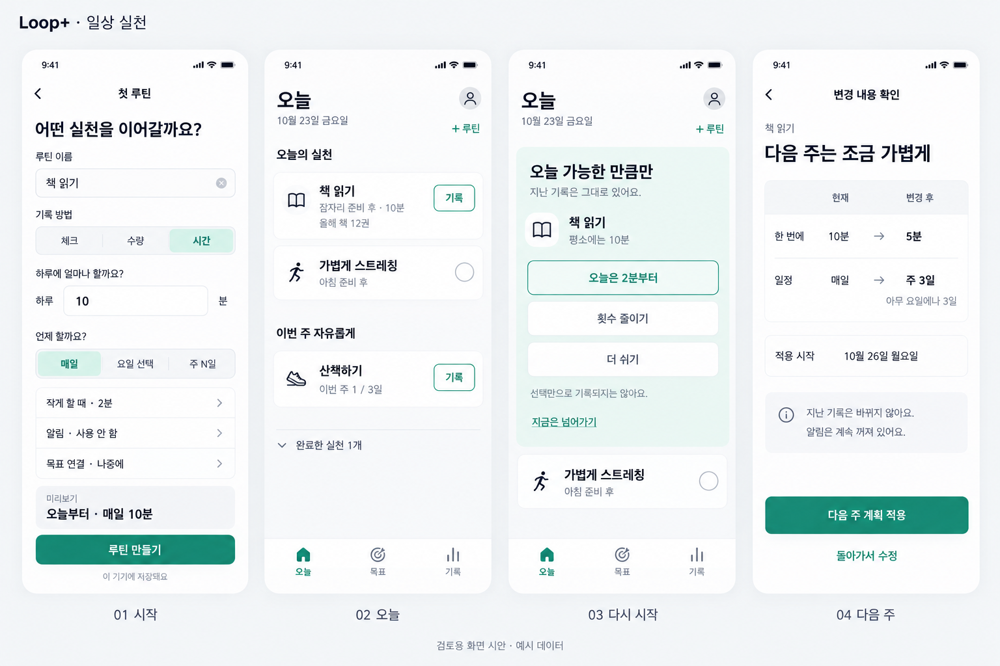
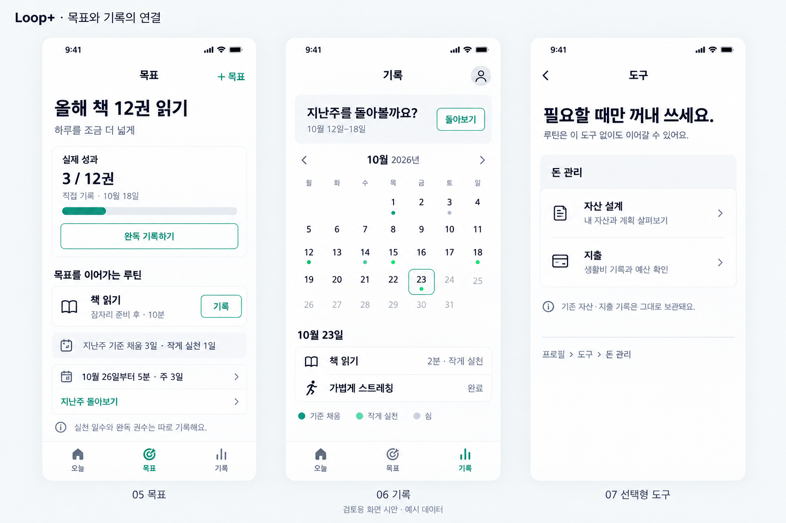

# Looplus — 네 가지 핵심 흐름 화면 설계

> 2026-10-23 · v0.3 · **화면 제안 / 앱 구현 전**
>
> 승인된 범위: 개인 습관·동기부여, iOS/Android, 오늘·목표·기록 3탭, 금융 선택형.
> 이번 산출물: 화면 구조, 와이어프레임, 실제 UI 문구, 전환, 저장 시점, 예외 상태, 검증 기준.
> 미포함: 동작하는 앱/클릭 프로토타입, DB 변경, 알림 구현, 시각 리브랜딩, 실기기 검증.
> v0.3: 제목용 NeoRound 방향 승인. 대표 루틴 선택→설정 확인→오늘과 선택형 전체 목록을 구체화했다.
> 폰트 구매·사용 계약·실제 서체 렌더링·앱 구현은 미완료다.

## 검토용 시안



이번 시안은 ‘고르기→설정 확인→오늘’ 세 화면과 선택 경로인 전체 목록을 보여준다.
사용자가 승인한 NeoRound 제목 방향을 참고하되 정식 파일을 사용한 렌더링은 아니다.
생성 이미지의 글자를 실제 상용 서체의 견본으로 간주하지 않는다. 정확한 문구와 동작은 명세를 따른다.
생성 방식: built-in imagegen, v0.1 보드를 시각 참조로 사용. 원문 프롬프트: `design/core-flows/routine-selection-v3-prompt.txt`.

이번 이미지에서 확인할 것은 선택 목록의 정보량, 기준·주기의 확인 순서, 추가와 실천 기록의 구분이다.
정확한 서체 굵기·터치 영역·명암 대비·큰 글자 대응을 이미지로 검증했다고 간주하지 않는다.
구현 시 ‘떠올릴 계기’는 알림과 다른 아이콘/문구를 쓰고, 추가 피드백의 체크는 루틴 완료 표시로 재사용하지 않는다.

### 이전 v0.1 시안 — 참고용

아래 첫 보드의 생성 폼은 v0.3의 대표 루틴 흐름으로 대체한다. 나머지 오늘·복귀·주간 계획의 구조 참고는 유지한다.



위 이미지는 네 흐름의 대표 상태를 나란히 놓은 시안이다. 모든 중간 화면을 포함한 실행 화면이 아니다.
기존 브랜드를 유지한 생성 이미지이며 제목용 서체 방향 승인과 별개로 사용자가 픽셀 단위 시안을 승인한 것은 아니다.
정확한 문구·날짜 규칙·오류/접근성 동작은 아래 명세를 기준으로 한다.
생성 방식: built-in imagegen. 원문 프롬프트: `design/core-flows/mockup-prompt.txt`.



두 번째 시안은 목표의 실제 성과와 루틴 실천을 구분하고, 기록에서 계획을 조정하며,
금융은 프로필의 선택형 도구로 접근하는 구조를 보여준다.
첫 시안을 시각 참조로 생성했다. 원문 프롬프트: `design/core-flows/companion-prompt.txt`.
시안 달력의 색상 표시는 구조 예시다. 실제 구현에서는 아래 접근성 명세에 따라 색상 외 기호·텍스트도 제공한다.

## 1. 이번 화면안의 기준

**Mode: Operate.** 일상에서 잠깐 열어 하나를 실행하고 닫는 개인 사용자를 위한 화면이다.
기존 잉크/틸 브랜드와 차분한 UI를 유지한다. 새로운 스타일 투표보다 합의된 ‘오늘의 실천 우선’ 구조를 구체화한다.
설계용 이름·수치·기록은 가상 예시이며 실제 사용자 자료가 아니다.

한 화면의 목적은 하나다. 가입·금융·목표 작성은 첫 루틴을 만드는 조건이 아니다.
‘하려고 선택한 것’과 ‘실제로 한 것’을 분리하고, ‘저장됨’과 ‘동기화됨’도 분리한다.
아래 와이어프레임은 정보 순서와 행동의 명세다. 공백 수·박스 모양은 픽셀 규격이 아니다.
검토용 생성 이미지는 전체 인상을 보여주며, 정확한 문구·조건·숫자의 기준은 이 문서다.

## 2. 전체 구조와 화면 지도

```text
오늘                         목표                         기록
├─ 첫 루틴 만들기 [F1]       ├─ 목표 목록 [G-01]          ├─ 기록 홈 [H-01]
├─ 실천 기록 [F2]            ├─ 목표 상세 [G-02]          ├─ 날짜별 기록/수정
├─ 복귀 제안 [F3]            └─ 연결 루틴 → 오늘/기록     └─ 주간 돌아보기 [F4]
└─ 루틴 관리                                             └─ 계획 적용 → 오늘

프로필 → 계정·백업 / 알림 / 도구 / 데이터 관리 / 도움말
                          └─ 돈 관리 (선택형)
```

- 탭마다 탐색 stack/스크롤을 보존한다. 완료 후 홈 전체를 새로 시작시키지 않는다.
- 목표 상세에서 ‘루틴 추가’를 누르면 해당 목표만 미리 연결된다. 제목·일정·완료는 임의 생성하지 않는다.
- 기록에서 계획을 바꾸면 대상 루틴과 적용일을 오늘·목표에서도 확인할 수 있다.
- 새 사용자에게 ‘설계·실행·로드맵’이라는 별도 탐색 용어를 섞지 않는다.
- 루틴/회고 같은 집중 작업은 전체 화면 또는 OS 시트로 연다. 그 안에 두 번째 탭 바를 만들지 않는다.
- 앱의 첫 화면은 빈 ‘오늘’이다. 로그인 화면이나 강제 튜토리얼이 아니다.

### 화면 ID

| 흐름 | 화면 | 형태 | 하나의 주 행동 |
|---|---|---|---|
| 첫 시작 | F1-00 빈 오늘 | 오늘 탭 | 첫 루틴 만들기 |
| 첫 시작 | F1-01 루틴 고르기 | 전체 화면 | 대표 루틴 선택/직접 만들기 |
| 첫 시작·선택 경로 | F1-01L 전체 목록 | 같은 생성 stack | 분야에서 루틴 선택 |
| 첫 시작 | F1-02 루틴 설정 | 전체 화면 | 루틴 만들기 |
| 첫 시작 | F1-03 생성 후 오늘 | 오늘 탭 | 실제로 했다면 기록 |
| 오늘 | F2-00 오늘 목록 | 오늘 탭 | 해당 실천 기록 |
| 오늘 | F2-01 수량/시간 기록 | 시트 | 기록 저장 |
| 오늘 | F2-02 기록 후 피드백 | 목록 상태 | 필요 시 되돌리기 |
| 복귀 | F3-00 복귀 초대 | 오늘 안 인라인 | 오늘은 작게 |
| 복귀 | F3-01 최소 행동 제안 | 루틴 상세/시트 | 실제로 한 뒤 기록 |
| 복귀 | F3-02 더 쉬기 | 시트 | 쉬는 기간 저장 |
| 회고 | F4-01 주간 요약 | 기록 stack | 다음 계획 보기 |
| 회고 | F4-02 변경 선택 | 같은 stack | 한 가지 변경 선택 |
| 회고 | F4-03 적용 확인 | 같은 stack | 계획 적용 |
| 회고 | F4-04 적용 결과 | 결과 화면 | 오늘로 돌아가기 |
| 연결 | G-01/02 목표 목록/상세 | 목표 탭/stack | 목표 확인 → 루틴 실행 |
| 연결 | H-01 기록 홈 | 기록 탭 | 기록 확인 또는 주간 돌아보기 |

## 3. F1 — 첫 루틴 만들기

### F1-00 · 빈 오늘

```text
오늘                                      프로필
10월 23일 금요일

하나부터 시작해 볼까요?
이어가고 싶은 실천 하나면 충분해요.

[ 첫 루틴 만들기 ]

이미 사용하고 있나요? 기록 가져오기

이 기기에 저장돼요.
백업은 나중에 설정할 수 있어요.

──────────────────────────────────────────────
         오늘          목표          기록
```

- 첫 화면에 0일 스트릭·0%·빈 잔디를 배치하지 않는다.
- ‘기록 가져오기’는 계정 복원과 지원되는 파일 가져오기 경로다. 실제 가져오기 기능이 없으면 해당 메뉴를 약속하지 않는다.
- 목표·기록 탭은 열 수 있지만 루틴부터 해야 한다고 막지 않는다.

### F1-01 · 루틴 고르기

```text
‹ 오늘                         루틴 고르기

하나 골라, 나답게 시작해요.
시간과 횟수는 다음 화면에서 바꿀 수 있어요.

[ 루틴 검색: 독서, 산책, 정리...             ]

처음 시작하기 좋은 루틴
책 읽기             10분 · 매일          ›
가볍게 스트레칭      2분 · 매일           ›
하루 한 줄 남기기    체크 · 매일          ›
가볍게 산책하기      5분 · 주 3일         ›
한 곳 정리하기       3분 · 매일           ›
내일 할 일 하나 정하기  체크 · 매일       ›

[ 모든 루틴 보기 · 24개 ]
[ 직접 만들기 ]
```

- 최초 진입, 오늘의 +루틴, 목표 상세의 루틴 추가가 같은 선택 화면을 사용한다. 별도 ‘발견’ 탭은 만들지 않는다.
- 첫 화면은 편집 선정한 6개만 보여준다. 실제 사용 근거가 없는 ‘인기’, ‘맞춤 추천’ 배지는 붙이지 않는다.
- 초기 24개는 6개 분류로 준비한다. ‘모든 루틴 보기’에서 분류를 펼치며 성격 설문이나 관심사 선택을 선행시키지 않는다.
- 검색은 목록의 이름·동의어(예: 독서→책 읽기)에 대해 기기에서 처리한다. 결과가 없으면 ‘직접 만들기’에 검색어를 초안으로 넘긴다.
- 목록은 아이콘·이름·기준/주기·진입 표시의 단순한 한 열 구조다. 큰 이미지 카드, 회전 배너, 숨은 가로 스와이프에 의존하지 않는다.
- 작은 화면에서 목록 전체가 한 번에 보일 필요는 없다. 글자를 줄이지 않고 스크롤하며, 검색·직접 만들기 경로는 쉽게 찾을 수 있게 한다.
- 항목을 누르면 F1-02에 제목·기록 방식·기준·반복·작게 할 때를 **초안으로 채운다**. 이 단계에서는 생성·완료·알림 요청이 일어나지 않는다.
- 확인 화면에서 기준과 주기를 바로 수정하고 ‘내 루틴에 추가’를 누른다. 세부 항목은 접어 둔다. 기본값을 받아들이는 사용자는 선택→확인 두 단계면 된다.
- 최초에는 한 개씩 시작한다. 묶음 자동 등록·여러 개 선택 요구·유료 잠금은 출시 기본 흐름에 넣지 않는다.
- 직접 만들기는 이름 빈 값·체크형·매일을 수정 가능한 초안으로 제공하며 저장 전에 일정을 보여준다.
- 검색어·분류·스크롤 위치를 뒤로가기에 보존한다. 편집 중 다른 템플릿으로 바꾸려면 기존 초안을 덮는다는 확인이 필요하다.

#### F1-01L · 모든 루틴 — 선택 경로

```text
‹ 루틴 고르기                   모든 루틴

나에게 맞는 실천
[ 루틴 검색                                ]
6개 분야 · 24개 루틴

몸 움직이기                         4       ›
마음 돌보기                         4       ›
배우기                              4       ⌄
  책 읽기                    10분 · 매일    ›
  외국어 표현 익히기          3개 · 주 3일   ›
  강의 이어 보기              10분 · 주 3일  ›
  배운 내용 메모하기          3줄 · 주 3일   ›
집중하기                            4       ›
생활 정돈                           4       ›
관계·취미                           4       ›

[ + 직접 만들기 ]
```

- 이 화면은 온보딩 필수 단계가 아니다. 기본 6개에서 바로 선택하면 거치지 않는다.
- 분야 제목은 펼치기 동작이지 사용자 성향/관심사 설정이 아니다. 펼쳐진 상태를 보존하고 여러 분야를 동시에 열 수 있다.
- 도착 시에는 모든 분야를 접어 둔다. 시안의 ‘배우기’ 펼침은 사용자가 해당 분야를 누른 상태다.
- 검색은 접힌 분야를 포함한 전체 24개를 대상으로 한다. 검색 중에는 결과 목록과 개수를 표시하며 검색어를 지우면 이전 분야 펼침 상태로 돌아간다.
- 검색 결과 없음: ‘찾는 루틴이 없나요? 직접 만들어 보세요.’와 검색어가 채워지는 직접 만들기 버튼. 다른 탭으로 보내지 않는다.
- 중복 항목은 완료 체크 대신 ‘이미 사용 중’ 텍스트와 ‘내 루틴 보기’를 표시한다. 새로 만들기는 명시적 보조 선택이다.
- 기본 목록은 기기에 있어 로딩이 필요하지 않다. 원격 갱신 실패로 기존 목록을 비우거나 선택을 차단하지 않는다.
- 분야 행과 항목 행은 화면 읽기에서 구분한다. 분야에는 펼침 여부·항목 수, 루틴에는 제목·기준·주기를 읽어준다.

#### 출시용 대표 루틴 24개 — 편집 초안

아래 시간·횟수는 편의를 위한 수정 가능한 시작값이며 건강상 권장량이나 효과의 보장이 아니다.
‘체크’의 작게 할 때는 별도 대안 행동이다. 정규 완료로 자동 합산하지 않는다.
계기 문구는 예시일 뿐 자동 알림 시간이 아니다. 모든 템플릿의 알림은 off, 목표 연결은 없음으로 시작한다.

| 분류 | 대표 루틴 | 기록·기준 | 반복 | 작게 할 때 | 떠올릴 계기 예시 |
|---|---|---|---|---|---|
| 몸 움직이기 | 가볍게 스트레칭 | 시간 2분 | 매일 | 1분 | 오래 앉아 있다 일어난 뒤 |
| 몸 움직이기 | 가볍게 산책하기 | 시간 5분 | 주 3일 | 1분 | 점심 정리 후 |
| 몸 움직이기 | 좋아하는 음악에 맞춰 움직이기 | 시간 3분 | 주 3일 | 1분 | 음악을 켠 뒤 |
| 몸 움직이기 | 편한 움직임 연습하기 | 시간 5분 | 주 3일 | 1분 | 일정이 끝난 뒤 |
| 마음 돌보기 | 하루 한 줄 남기기 | 체크 | 매일 | 단어 하나 적기 | 하루를 마무리할 때 |
| 마음 돌보기 | 잠깐 조용히 쉬기 | 시간 3분 | 매일 | 1분 | 하던 일을 마친 뒤 |
| 마음 돌보기 | 오늘의 기분 돌아보기 | 체크 | 매일 | 기분 단어 하나 떠올리기 | 저녁 식사 후 |
| 마음 돌보기 | 좋았던 일 적기 | 수량 3개 | 주 3일 | 1개 | 잠자리 준비 후 |
| 배우기 | 책 읽기 | 시간 10분 | 매일 | 2분 | 잠자리 준비 후 |
| 배우기 | 외국어 표현 익히기 | 수량 3개 | 주 3일 | 1개 | 아침 준비 후 |
| 배우기 | 강의 이어 보기 | 시간 10분 | 주 3일 | 2분 | 책상에 앉은 뒤 |
| 배우기 | 배운 내용 메모하기 | 수량 3줄 | 주 3일 | 1줄 | 학습을 마친 뒤 |
| 집중하기 | 한 가지 일에 집중하기 | 시간 10분 | 주 3일 | 2분 | 작업을 시작할 때 |
| 집중하기 | 내일 할 일 하나 정하기 | 체크 | 매일 | 할 일 목록 열어 보기 | 하루를 마무리할 때 |
| 집중하기 | 시작 전 책상 정리하기 | 시간 2분 | 주 3일 | 1분 | 작업을 시작할 때 |
| 집중하기 | 오늘 한 일 돌아보기 | 체크 | 주 3일 | 한 일 하나 떠올리기 | 작업을 마친 뒤 |
| 생활 정돈 | 한 곳 정리하기 | 시간 3분 | 매일 | 1분 | 집에 돌아온 뒤 |
| 생활 정돈 | 침대 정돈하기 | 체크 | 매일 | 베개만 정리하기 | 일어난 뒤 |
| 생활 정돈 | 내일 준비물 챙기기 | 체크 | 매일 | 준비물 하나 확인하기 | 잠자리 준비 후 |
| 생활 정돈 | 잠들기 전 휴대폰 내려놓기 | 체크 | 매일 | 화면을 끄고 뒤집어 놓기 | 잠자리에 들 때 |
| 관계·취미 | 안부 한 번 전하기 | 체크 | 주 1일 | 전할 말 한 줄 써두기 | 여유가 생겼을 때 |
| 관계·취미 | 고마운 마음 표현하기 | 체크 | 주 1일 | 고마운 점 하나 적어두기 | 대화를 마친 뒤 |
| 관계·취미 | 좋아하는 취미 이어가기 | 시간 10분 | 주 3일 | 2분 | 일과를 마친 뒤 |
| 관계·취미 | 오늘의 장면 남기기 | 체크 | 주 3일 | 장면을 단어 하나로 적기 | 기억하고 싶은 순간 뒤 |

- 걷기나 특정 동작을 필수로 만들지 않는다. 수행량·행동을 사용자 상황에 맞게 바꾸거나 직접 만들 수 있다.
- 감량·칼로리 제한·수면 시간 단축·복약 변경·투자 행동을 기본 루틴으로 권하지 않는다.
- 일기·사진·외국어 학습·연락·음악 재생의 전용 기능을 제공한다는 뜻이 아니다. 사용자가 앱 밖에서 수행한 행동을 기록한다. 사진 권한·연락처를 요구하지 않는다.
- 기본 목록에 금융을 섞지 않는다. 사용자가 직접 돈 관련 루틴을 만들거나 선택형 도구에서 연결하는 것은 허용한다.

#### 내 루틴으로 복사하는 규칙

- 템플릿과 사용자 루틴은 별개다. 생성 시 설정을 복사하고 출처 ID/버전을 남긴다. 운영자가 템플릿을 바꿔도 기존 사용자의 기준·일정·기록은 변하지 않는다.
- 활성 루틴에 같은 템플릿이 있으면 ‘이미 사용 중’과 해당 루틴 열기를 제공한다. ‘새로 만들기’도 명시적으로 선택할 수 있다. 제목만 같다는 이유로 병합하지 않는다.
- 중지/보관한 루틴은 ‘이전 루틴 보기’를 제공하고 임의 재활성화하지 않는다.
- 초기 목록은 앱에 포함해 오프라인에서도 고를 수 있다. 나중에 원격 갱신하더라도 검증 실패 시 마지막 정상 목록을 유지한다.
- 수집할 수 있는 검증 지표는 목록 열기→선택→생성 전환, 기본값 수정 비율, 첫 실천 여부다. 사용자 루틴 제목·검색어 원문은 분석 이벤트에 보내지 않는다.

### F1-02 · 한 화면에서 확인·설정

```text
‹ 루틴 고르기                   루틴 설정

내 생활에 맞춰요.
책 읽기                              바꾸기
시간으로 기록하는 루틴

한 번에 얼마나 할까요?
[ 10 ] 분

언제 반복할까요?
[ 매일✓ | 요일 선택 | 주 N일 ]

작게 할 때        2분                        ›
떠올릴 계기       나중에                     ›
알림              사용 안 함                  ›
목표 연결         나중에                      ›

오늘부터 · 매일 10분
[ 내 루틴에 추가 ]
추가만으로 실천이 기록되지는 않아요.
```

**필수:** 제목, 기록 방식, 기준값(체크형 제외), 반복 주기.
**선택:** 최소 행동, 계기 문구, 알림, 목표 연결. 선택 항목은 접힌 row로 유지한다.
템플릿에서 온 제목·기록 방식은 기본값으로 먼저 보여주고 ‘바꾸기’로 편집한다. 직접 만들기는 입력 필드를 펼친다.
직접 만들기의 주 버튼은 ‘루틴 만들기’다. 두 버튼 모두 실제 수행이 아닌 루틴 설정만 저장한다.
‘바꾸기’는 제목과 기록 방식을 펼쳐 편집하는 동작이다. 시간·수량·체크를 바꾸면 해당 기준/최소 행동을 다시 확인하며 옛 단위를 묵시적으로 변환하지 않는다.
v0.3의 버튼 문구는 등록과 수행의 혼동을 줄이려는 설계 판단이다. 사용자 테스트로 효과를 확인한 것은 아니다.
게스트 저장 범위는 F1-00에서 안내하고 추가 후 ‘이 기기에 저장됨’ 상태로 확인할 수 있게 한다.

세부 동작:

- ‘요일 선택’은 월~일 선택을 펼친다. 0개 선택은 저장 전 해당 필드에서 안내한다.
- ‘주 N일’은 1~7일과 ‘아무 요일에나’를 표시한다. 특정 요일 선택과 동시에 요구하지 않는다.
- 주 중간 생성으로 남은 날짜가 N보다 적으면 ‘이번 주는 남은 2일, 다음 주부터 3일’처럼 첫 주 기준을 **미리보기에서 명시하고 확인**한다. 조용히 목표를 바꾸지 않는다.
- 최소 행동은 0보다 크고 정규 기준보다 작은 값이어야 한다. 체크형은 선택적인 짧은 대안 문구를 허용하며 정규 완료와 별도로 기록한다.
- ‘언제 떠올릴까요?’는 ‘잠자리 준비 후’ 같은 사용자가 작성하는 계기다. 알림 시각과 다르다.
- 알림을 켜기로 선택하면 목적을 설명하고 OS 권한을 요청한다. 거부하면 루틴은 생성되고 알림은 off로 표시된다.
- 제목 누락/기준값 오류는 입력 옆에 보이며 다른 입력은 보존한다. 키보드가 CTA나 오류를 가리지 않는다.
- 뒤로가기·앱 전환 시 **초안**을 보존한다. 초안은 오늘 목록이나 알림을 만들지 않는다.
- 저장은 habit+initial plan+outbox의 로컬 트랜잭션 성공 후 완료한다. 중복 탭은 같은 draft id로 한 번만 생성한다.

### F1-03 · 생성 직후

오늘 목록에 새 루틴이 미완료로 보인다. 짧은 피드백: ‘책 읽기 루틴을 추가했어요.’
다음 예정일이 오늘이 아니면 ‘다음 실천은 월요일이에요’와 다음 날짜를 표시한다.
성공 화면을 거쳐 다시 확인 버튼을 누르게 하지 않는다. 가입·알림·목표 연결 팝업을 연달아 띄우지 않는다.
새로 만든 것을 실행 기록으로 집계하지 않는다.

v0.3 시안은 아무 루틴도 없던 사용자가 책 읽기 하나를 추가한 직후다.
오늘 카드에는 ‘책 읽기 · 10분 · 매일’과 ‘기록’ 버튼만 표시한다. 목표 연결이나 계기 문구를 임의 생성하지 않는다.
‘실제로 읽은 뒤 기록해 주세요.’와 ‘바쁜 날에는 2분부터 해도 좋아요.’를 보조 안내로 제공한다.
이후 기록이 생기면 같은 생성 안내를 계속 반복하지 않는다. 완료 체크·성공 일수·축하 애니메이션은 생성만으로 표시하지 않는다.

**검증 기준:** 도움 없이 첫 설정 60초 이내를 목표로 한다. 템플릿 선택 후 기준·주기를 확인하고 한 번 생성한다.
‘내 루틴에 추가’와 ‘기록’이 서로 다른 행동임을 이해하는지 테스트한다.

## 4. F2 — 오늘 실천

### F2-00 · 평소의 오늘

```text
오늘                                      프로필
10월 23일 금요일                         + 루틴

오늘의 실천
┌────────────────────────────────────────────┐
│ 책 읽기                         [ 기록 ]   │
│ 잠자리 준비 후 · 10분                       │
│ 올해 책 12권                               │
├────────────────────────────────────────────┤
│ 가볍게 스트레칭                    ( ○ )   │
│ 아침 준비 후                               │
└────────────────────────────────────────────┘

이번 주 자유롭게
산책하기                          [ 기록 ]
이번 주 1 / 3일

완료한 실천 1개                              ⌄

──────────────────────────────────────────────
         오늘          목표          기록
```

- 고정 예정과 주 N일 자유 실천은 구역을 나누되 하나의 화면에서 실행한다.
- 전 항목에 완료/작게/쉬기 버튼을 세 개씩 늘어놓지 않는다. 1차는 기록, 다른 선택은 상세의 일관된 위치에 둔다.
- 체크형 원 버튼의 접근성 이름은 ‘가볍게 스트레칭 완료하기’. 아이콘만으로 역할을 숨기지 않는다.
- 제목을 누르면 상세, 완료 영역을 누르면 기록. 중첩 클릭으로 두 동작이 함께 실행되지 않는다.
- 20개 이상이면 사용자가 정한 시간대/순서를 유지하고 완료 그룹을 접는다. 새 그룹 분류를 강제로 요구하지 않는다.
- 주 N일 기준을 채우면 ‘이번 주 목표를 채웠어요’. 더 기록할 수 있지만 추가 의무처럼 노출하지 않는다.
- 예정이 없는 날은 ‘오늘 예정된 루틴은 없어요’. 주간 자유 실천이 남았다면 그 목록은 별도로 보여준다.

### F2-01 · 실제 양 기록

```text
닫기                            책 읽기
오늘 총 얼마나 읽었나요?

오늘 총 읽은 시간
[       ] 분

[ 2분 ]      [ 5분 ]      [ 10분 ]
오늘의 기준 10분 · 작게 할 때 2분

[ 기록 저장 ]

오늘은 쉬기
```

- 신규 기록은 빈 입력. 단축값은 사용자가 눌러 초안을 채우며 저장 전에는 완료되지 않는다.
- 기존 기록이 있으면 현재 총량으로 채우고 ‘기록 수정’이라고 표시한다.
- **합계 입력**이므로 2분 → 5분은 총 5분이지 7분이 아니다. 라벨을 모든 진입 경로에서 유지한다.
- 정규 기준보다 큰 실제 값도 기록 가능하다. 25분을 읽었는데 10분으로 자르지 않는다.
- 최소 기준 이상/정규 기준 미만은 ‘작게 실천’, 둘 다 미만이면 실제 값을 표시한다. 정규 달성으로 합치지 않는다.
- 시트를 열거나 최소값을 선택하는 것만으로 기록하지 않는다.
- 수량형은 같은 구조로 단위만 바꾼다. 단위·정밀도는 루틴 설정의 기준을 따른다.
- ‘오늘은 쉬기’는 당일 occurrence의 선택이다. 이미 기록된 값이 있으면 이를 조용히 지우지 않고 기록 유지/수정 경로를 제공한다.

### F2-02 · 즉시 확인과 되돌리기

로컬 저장 성공 후 row에 ‘10분 완료’ 또는 ‘2분 · 작게 실천’이 보인다.
작은 피드백 ‘기록했어요 · 되돌리기’를 제공한다. 잠깐의 피드백이 사라져도 상세에서 수정/취소할 수 있다.
기록 직후 row를 멀리 이동시키지 않아 다음 터치를 가로채지 않는다. 완료 그룹 정리는 다음 진입 또는 사용자 접기 시 반영한다.

| 저장 결과 | 화면 표시 | 할 수 있는 일 |
|---|---|---|
| 로컬 성공·온라인 전송 중 | 기록 유지, ‘백업 대기’ | 계속 기록 |
| 로컬 성공·오프라인 | 기록 유지, ‘이 기기에 저장됨’ | 계속 기록, 나중에 동기화 |
| 로컬 저장 실패 | 완료 확정 안 함, 입력 유지 | 다시 저장 |
| 서버 충돌 | 해당 기록에 ‘두 기기의 기록 확인’ | 두 값 비교/선택, 다른 항목 계속 사용 |

**검증 기준:** 체크형은 오늘에서 1탭, 수량/시간은 입력 시트를 포함한 명시적 기록 경로. 버튼 탭만 했다는 이유로 실제 행동을 추정하지 않는다.

## 5. F3 — 쉬었다가 복귀

### F3-00 · 인라인 복귀 초대

```text
오늘                                      프로필
10월 23일 금요일

오늘 가능한 만큼만
지난 기록은 그대로 있어요.

책 읽기
평소에는 10분

[ 오늘은 2분부터 ]
횟수 줄이기                                 ›
더 쉬기                                     ›

선택만으로 기록되지는 않아요.
지금은 넘어가기

가볍게 스트레칭                            ( ○ )

──────────────────────────────────────────────
         오늘          목표          기록
```

초대 조건은 일정형 루틴의 예정 기회 연속 미기록 등 명시적 규칙으로 계산한다. 단순히 앱을 안 열었다고 실패로 간주하지 않는다.
주 N일은 일별 공백이 아니라 마감된 주의 미달 기준을 사용한다. 보관/계획된 휴식 기간은 복귀 실패에 포함하지 않는다.
여러 루틴이 해당하면 한 번에 하나만 제안하며, 다른 루틴을 숨기거나 계획을 자동으로 줄이지 않는다.
‘지금은 넘어가기’를 누르면 그날 다시 띄우지 않는다. 반복 노출/숨김 기간은 검증할 제품 가설이다.
최소 행동을 정의하지 않은 루틴은 ‘오늘 다시 이어가기’를 보여주고 2분 같은 수치를 임의로 만들지 않는다.

### F3-01 · ‘2분부터’의 정확한 의미

```text
‹ 오늘                         책 읽기

오늘은 2분부터 해볼까요?
평소 기준 10분은 그대로예요.

준비가 되면 읽고 돌아오세요.

[ 2분 했어요 ]
다른 시간 기록하기
```

- 복귀 초대의 ‘2분부터’를 누르면 이 행동 제안으로 이동한다. **이 시점에는 기록이 없다.**
- ‘2분 했어요’를 누르는 명시적 자기보고에서만 2분 기록을 저장한다.
- 이미 2분 이상 기록했다면 덮어쓰지 않는다. 현재 기록과 ‘기록 수정’을 보여준다.
- 같은 날 10분까지 이어가면 F2-01에서 오늘 총량을 수정한다. 최소/정규 완료를 각각 두 번 집계하지 않는다.
- 타이머는 v1의 필수 전제가 아니다. 켜지지 않는 가짜 시작 버튼을 만들지 않는다.
- 정상 기준을 줄이는 결정과 ‘오늘만 작게 하기’를 분리한다.

### F3-02 · 더 쉬기

```text
닫기                         책 읽기 쉬기

얼마나 쉬어갈까요?
○ 내일 다시 시작
○ 날짜 정하기                  10월 28일
○ 내가 다시 시작할 때까지

선택한 기간에는 예정과 알림을 쉬어요.
지난 기록은 남아 있어요.

[ 쉬는 기간 저장 ]
```

- 시작은 오늘, 재개일은 선택한 날짜의 시작이다. 저장 전 ‘오늘부터 10/27까지 쉼 · 10/28 재개’처럼 범위를 보여준다.
- 오늘 이미 한 기록은 보존한다. 과거 예정 기회를 중지로 소급 변경하지 않는다.
- ‘직접 재개’는 재개일을 꾸며내지 않는다. 루틴 관리의 ‘쉬는 중’에서 항상 다시 시작할 수 있다.
- 저장은 로컬 pause 반영 후 완료한다. OS 알림 취소가 실패하면 ‘알림 정리 대기’와 재시도를 표시하고 중지가 안 된 것처럼 숨기지 않는다.
- ‘횟수 줄이기’는 F4의 변경 편집기 재사용, 적용일 기본 오늘. 변경 대상/내용을 확인한 뒤 적용한다.

**검증 기준:** 사용자가 과거를 만회하지 않아도 오늘 한 번 실천할 수 있고, 초대 자체를 거절해도 앱 사용에 불이익이 없다.

## 6. F4 — 주간 계획 조정

### 진입과 기간

기록 탭에서 최근 마감된 주를 기본으로 연다. 예시 주간은 10월 12–18일이며, 다음 적용일 예시는 10월 26일이다.
이번 주를 먼저 돌아볼 수도 있지만 ‘현재까지’와 집계 기준 시각을 표시하고 남은 날짜를 미기록으로 확정하지 않는다.
통계가 없는 첫 주에는 ‘기록이 쌓이면 주간 요약이 생겨요’와 간단한 메모만 제공한다. 비교 숫자를 만들지 않는다.

### F4-01 · 사실과 선택적인 느낌

```text
‹ 기록                         주간 돌아보기
10월 12일 – 18일

이번 주에는 이렇게 이어갔어요
책 읽기
기준 채움 3일 · 작게 실천 1일 · 쉼 1일
기록 없음 2일

이번 계획은 어땠나요?                    선택
[ 괜찮았어요 ] [ 조금 버거웠어요 ] [ 바꾸고 싶어요 ]

[ 다음 계획 보기 ]
나중에 이어하기
```

- 7일의 상태를 중복 없이 분류한다. ‘4일 실천’과 ‘3일 기준 채움’을 혼용하지 않는다.
- 여러 루틴이면 전체를 과도한 점수로 합치지 않고 루틴별 한 줄을 보여준다.
- 느낌을 선택했다고 자동으로 일정 변경을 제안/확정하지 않는다. 선택 입력을 건너뛸 수 있다.
- 회고 초안을 기간 id로 저장한다. 탭 전환·앱 종료 후 같은 단계로 돌아온다.

### F4-02 · 한 가지 변경

```text
‹ 주간 요약                    다음 계획

다음에는 어떻게 이어갈까요?
[ 그대로 이어가기 ]
[ 한 가지만 조정하기 ]
[ 기간을 정해 쉬기 ]

조정할 루틴     책 읽기                       ›
한 번의 기준    10분 → [ 5 ] 분
반복           매일 → [ 주 3일 ]

[ 변경 내용 확인 ]
```

- ‘유지’는 새 루틴/계획 버전을 불필요하게 복제하지 않고 회고 결정만 저장한다.
- 조정은 대상 루틴 선택 후 기준량/빈도/계기/알림 중 필요한 항목만 편집한다.
- 한 루틴 변경을 기본으로 돕지만 여러 루틴을 수정하고 싶다면 수정 목록에 추가할 수 있다. 몰래 전체 루틴에 적용하지 않는다.
- 목표 A에서 진입하면 A에 연결된 루틴을 먼저 보여주되 대상 id와 제목을 끝까지 유지한다.
- 목표를 바꾸면 기존 메모/변경을 새 목표에 자동 재귀속하지 않는다.
- 정규 기준을 기존 최소 기준 이하로 낮추면 최소 기준도 명시적으로 수정하거나 끄게 한다.
- 알림 off는 계속 off. ‘계획을 조정했다’는 이유로 권한 요청이나 알림 opt-in을 하지 않는다.

### F4-03 · 적용 전 비교

```text
‹ 수정                         변경 내용 확인

책 읽기
다음 주는 조금 가볍게

                   현재          변경 후
한 번에             10분       →   5분
일정                매일       →   주 3일
                                   아무 요일에나 3일

적용 시작           10월 26일 월요일           ›
작게 할 때          2분 유지
알림                사용 안 함 유지

지난 기록은 바뀌지 않아요.
[ 다음 주 계획 적용 ]
돌아가서 수정
```

- 기본 적용은 다음 주 월요일. 오늘부터도 선택할 수 있지만 과거 날짜는 선택할 수 없다.
- 변화가 없는 필드도 최소 기준·알림처럼 해석에 중요한 항목은 짧게 확인시킨다.
- 고정 요일→주 N일 변경 시 기존 일별 알림을 그대로 이어붙이지 않는다. 알림이 켜져 있었다면 별도 선택을 받아 정확한 새 알림 요약을 보여준다.
- 저장 직전 다른 기기에서 기준이 바뀌었다면 비교 화면을 새 기준으로 갱신하고 다시 확인받는다.
- 과거 기록과 진행 중인 기록은 당시 계획에 귀속된다. 미래 버전만 바뀐다.

### F4-04 · 결과와 시스템 경계

로컬 트랜잭션에서 회고 확정·PlanAdjustment·미래 PlanVersion·outbox를 함께 저장한다.
성공 후 ‘10월 26일부터 적용돼요’와 변경 요약, ‘예약된 변경 취소’, ‘오늘로’를 보여준다.
오늘 상세에는 적용일 전까지 ‘다음 주부터 5분 · 주 3일’이라는 예약 안내만 표시한다.

**OS 알림과 서버 전송은 로컬 DB와 같은 트랜잭션이 아니다.** 각각의 반영 대기를 구분한다.
알림 반영 실패를 전체 저장 성공 문구 뒤에 숨기지 않고, 계획은 보존한 채 재시도한다.
미래 변경 취소는 적용 전 버전 예약 취소다. 이미 적용된 변경은 새 유효일의 수정으로 처리하며 과거 기록을 되돌리지 않는다.
사용자가 취소한 변경이 다른 기기의 오래된 outbox에서 부활하지 않도록 revision을 확인한다.

**검증 기준:** ‘조정’과 ‘멈춤’이 메모로 끝나지 않고, 지정 날짜의 예정 계산에 실제 적용되어야 한다.

## 7. 연결 화면 — 목표·기록도 같은 일을 돕는다

### G-01 · 목표 목록

```text
목표                                      + 목표
내가 이어가고 싶은 변화

올해 책 12권 읽기
완독 3 / 12권 · 직접 기록
연결된 루틴: 책 읽기

생활비 여유 만들기
돈 관리 도구와 연결됨

목표 없이 이어가는 루틴도 괜찮아요.
──────────────────────────────────────────────
         오늘          목표          기록
```

두 번째 금융 목표는 **해당 목표가 이미 있는 사용자에게만** 보이는 예시다. 신규 기본 목록에 생성하지 않는다.
목표가 없으면 한 문장 안내·목표 만들기·오늘로만 보여준다. 목표가 없다는 이유로 오류/부족 상태를 만들지 않는다.

### G-02 · 목표 상세

헤더는 목표명과 선택한 이유. ‘실제 성과 3/12권’과 ‘이번 주 읽기 실천 4일’은 별도 행이다.
주 행동은 오늘 예정이 있다면 ‘오늘 읽기 기록’, 없으면 ‘연결 루틴 보기’. 이미 완료한 행동을 다음 할 일로 안내하지 않는다.
‘성과 기록’은 완독 권수 입력, ‘루틴 추가’는 목표가 연결된 F1-02로 이동한다.
수동 결과는 측정일을 보여주며, 독서 시간으로 완독 권수를 자동 추정하지 않는다.
관련 회고는 이 목표의 decision/메모만 표시한다.
완료를 선택하면 루틴을 유지할지 보관할지 묻되, 목표 완료만으로 연결 루틴을 삭제하지 않는다.

### H-01 · 기록 홈

```text
기록                                      프로필

이번 주를 돌아볼까요?
10월 12–18일                           [ 돌아보기 ]

10월                                ‹       ›
월   화   수   목   금   토   일
       날짜별 상태 표시 달력

선택한 날 · 10월 23일
책 읽기                    2분 · 작게 실천
가볍게 스트레칭             완료

기준 채움 / 작게 실천 / 쉼 / 기록 없음
──────────────────────────────────────────────
         오늘          목표          기록
```

- 달력은 색 외에 표식/접근성 이름으로 상태를 구분한다. 하루에 여러 상태면 상세에서 분해한다.
- 날짜 선택은 그날의 기록을 연다. 현재 루틴 설정을 과거에 소급 적용하지 않는다.
- 미래는 ‘예정’이며 과거 미기록과 다르다. 과거 기록 수정은 날짜를 분명히 보여준다.
- 기록 삭제·값 수정은 해당 날짜에서 가능하고, 요약 변경 사실을 회고 상세에 표시한다.
- 주간 돌아보기의 CTA는 기존 회고가 있으면 ‘이어쓰기’ 또는 ‘돌아보기 보기’로 바뀐다.

## 8. 금융 선택형의 구체적인 위치

1. **프로필 → 도구 → 돈 관리**에서 자산 설계·지출을 연다. 네 번째 탭으로 되돌아오지 않는다.
2. 금융 목표를 직접 선택한 사용자에게만 목표 상세에 ‘돈 관리 열기’를 제공한다.
3. 새 사용자 온보딩·일반 오늘·일반 회고에는 금융 입력/계좌 연결/자산 점수를 노출하지 않는다.
4. 기존 금융 사용자의 데이터·목표는 보존한다. 첫 전환 시 ‘자산 설계와 지출은 도구로 옮겼어요 · 열기’를 한 번 안내한다.
5. 기존 deep link는 해당 금융 화면에 도달해야 한다. 앱 안에서는 이전 맥락으로 돌아올 수 있게 한다.
6. 금융 도구 사용은 선택이며 다른 기능의 잠금 해제 조건이 아니다. 제휴 CTA로 대체하지 않는다.
7. 앱 v1에서 기존 금융 웹을 외부 브라우저로 열 경우 ‘웹에서 열림’을 미리 알린다. 네이티브 제공 여부는 기술 실험 후 결정하며 시안에서 이미 구현된 것처럼 표현하지 않는다.

## 9. 공통 화면 규칙과 예외

| 상태 | 화면 계약 |
|---|---|
| 첫 로딩 | 과거 캐시가 있으면 먼저 표시, 없으면 화면 구조 skeleton. 빈 기록으로 오인시키지 않음 |
| 앱 중단 | 루틴 설정/회고 초안 복원. 실행 예정/완료는 초안에서 생성 안 함 |
| 오프라인 | 핵심 일정·기록 사용, 기기 저장과 백업 상태 구분 |
| 알림 거부 | 기본 기능 유지, 설정 링크는 사용자가 알림을 다시 켜려 할 때 제공 |
| 긴 제목·큰 글자 | 줄바꿈, 수평 스크롤 없이 접근 가능, 중요 기준값 생략 안 함 |
| 여러 목표/많은 루틴 | 한 루틴의 주 연결 목표는 선택, 처음부터 깊은 분류를 요구하지 않음 |
| 목표 삭제/보관 | 루틴·실행 기록은 유지, 연결이 해제되었음을 필요한 위치에서 안내 |
| 저장 실패 | 입력 보존·명확한 재시도. 성공 haptic/체크를 먼저 확정하지 않음 |
| 계정 없음 | 데이터는 기기 단위임을 명시. 계정 연결 시 기존 기록과 병합 안내 |
| 자정·여행 | 저장 직전 귀속 날짜를 일관되게 사용. 과거 날짜 수정 화면에서는 그 날짜를 고정 |

iOS는 시스템 탐색/뒤로가기/시트, Android는 시스템 Back/IME inset/Material 제어를 따른다.
동일한 구조와 상태를 공유하지만 두 OS를 동일한 웹 chrome으로 강제하지 않는다.
터치 영역은 iOS 44pt·Android 48dp 이상을 목표로 한다. 큰 글자·화면 읽기·동작 줄이기·다크 모드를 구현 단계에서 검증한다.
화면 시안에 표시된 Light 모드만으로 다크 모드·접근성 통과를 선언하지 않는다.
모든 토스트 행동은 영구적인 상세 경로도 제공한다. 일시적인 Undo만이 기록 취소의 유일한 방법이어서는 안 된다.

## 10. 화면 문구 기준

| 쓰지 않을 표현 | 제안 표현 | 이유 |
|---|---|---|
| 3일째 실패했어요 | 오늘 가능한 만큼만 | 기록 없는 기간을 도덕적 실패로 해석하지 않음 |
| 최소 목표로 완료! | 2분 · 작게 실천 | 정규 기준을 채웠다는 오해 방지 |
| 모든 루틴 100% 달성하기 | 오늘의 실천 | 전체 완벽주의를 기본 목표로 만들지 않음 |
| 저장 완료 | 이 기기에 저장됨 / 백업됨 | 저장 위치와 상태를 구분 |
| 잠시 멈춤(메모만 저장) | 10월 28일 다시 시작 | 실제 일정의 변화와 동일한 표현 |
| 목표 달성률 33% | 완독 4/12권 · 직접 기록 | 단위·출처를 보여줌 |
| 알림 설정 완료(권한 거부 상태) | 알림 사용 안 함 | 실제 기능과 문구 일치 |

## 11. 설계 검토·사용성 테스트 시나리오

1. 금융·가입 없이 ‘책 읽기’를 만들고 생성과 실천 완료가 다르다는 것을 설명하는가?
2. 2분을 한 사용자가 정규 목표를 2분으로 바꾸지 않고 실제 기록을 남길 수 있는가?
3. 2분에서 총 5분으로 수정할 때 합계가 7분이라고 오해하지 않는가?
4. 주 3일 루틴을 보고 특정 요일에 묶인 것으로 생각하지 않는가?
5. 3일 후 돌아와 밀린 실천을 전부 처리하지 않고 오늘부터 시작하는가?
6. 기간 중지 후 알림/예정이 쉬고 과거 기록은 남는다는 것을 이해하는가?
7. 주간 계획 10분→5분을 적용하기 전에 적용 날짜를 확인하는가?
8. 회고 화면에서 나갔다 돌아와 초안을 잃지 않고 이어가는가?
9. 목표의 완독 권수와 루틴 실천 일수를 다른 지표로 이해하는가?
10. 기존 금융 사용자가 도움 없이 돈 관리 도구를 다시 찾는가?
11. 목록에서 원하는 루틴을 찾고, 기본값을 고치거나 그대로 확인해 한 개를 만들 수 있는가?
12. 이미 쓰는 루틴과 새로 만드는 루틴을 구분하며 템플릿 변경이 과거 기록을 바꾸지 않는가?

이번 결과는 시안과 명세의 일관성 검토이지 사용자 테스트 결과가 아니다.
다음 단계는 이 명세로 클릭 가능한 프로토타입을 만들고 위 과제를 관찰하는 것이다.

## 12. 구현 인계와 변경 경계

| 설계 영역 | 다음 구현에서 영향받을 현재 코드/새 모듈 |
|---|---|
| 3탭·금융 진입 | `AppShell.tsx`, 계정/도구 탐색, 기존 route 호환 |
| 첫 루틴·오늘 | onboarding, home, TrackingPanel을 대체/분리할 모바일 화면 |
| 공통 예정/기록 규칙 | `tracking.ts`, `types.ts`에서 분리할 habit 도메인 |
| 회고→계획 적용 | WeeklyReviewPanel, weeklyReview 도메인, 계획 변경 command |
| 목표/기록 맥락 | LoopDashboard, GoalLoopDetail, 목표별 회고 연결 |
| 저장/이전 | useProfile, SyncManager, supabaseRepo, 별도 migration adapter |

본 문서의 화면 ID와 제안 UI는 구현 완료가 아니다. 현재 Next.js 화면과 저장 형식은 그대로다.
시각 리브랜딩·실제 알림 권한 요청·운영 마이그레이션·스토어 제출은 이번 화면 설계 범위 밖이다.
다음 단계 전에 확인할 핵심은 첫 생성 폼의 간결함, 최소 실천의 이해, 회고 변경 적용의 명확함이다.

## 13. 타이포그래피 개선안 — NeoRound 제목 방향 확정

### 현재 상태와 바꿀 이유

현재 코드와 기존 디자인 문서를 기준으로 확인한 내용이다. 새 앱에 이미 적용된 결과가 아니다.

- `src/app/globals.css`: 본문은 Pretendard Variable, 기본 크기 15px·행간 1.5. 제목은 SUIT Variable 800·자간 -0.03em이다.
- 기존 제목의 굵고 조밀한 인상에서, 일상 앱에 맞는 부드러운 획과 넉넉한 문장 호흡으로 이동한다. 이 평가는 디자인 판단이며 사용성 효과를 검증한 것은 아니다.
- `src/components/panels/TrackingPanel.tsx`에는 10–11px 보조 문구가 여러 곳 있다. 서체 교체와 별개로 새 화면의 핵심 안내는 본문 크기로 올려야 한다.
- 기존 `font-sans`/`font-display`는 역할이 분리되어 있다. 세 번째 장식 폰트를 추가하지 않고 display 역할을 교체하는 안으로 범위를 제한한다.
- SUIT는 외부 CDN, Pretendard는 프로젝트 의존성의 분할 웹폰트다. 새 상용 파일의 배포 방식·실제 크기·fallback 폭은 아직 확인되지 않았다.
- 현재 CSS/layout만 대상으로 한 type 탐지 결과는 0건이었다. 컴포넌트 전체 검사, 실제 새 서체 로딩·줄바꿈·접근성 검증을 통과했다는 뜻은 아니다.

### 승인된 방향과 비교 기록

| 후보 | 공식 확인 사항 | Looplus에서의 디자인 판단 | 판단 상태 |
|---|---|---|---|
| **Sandoll 고딕NeoRound** | 9개 굵기, 한글 11,172자. 본문/제목 활용을 설명하는 공식 견본 제공 | 둥근 획으로 따뜻함을 주되 손글씨처럼 과장하지 않음. 첫 시작·오늘 제목·복귀 문구에 사용 | 제목용 디자인 방향 사용자 승인, 구매/앱 배포 권한 미확정 |
| Sandoll 고딕Neo3유니 | 7개 굵기, 한글 11,172자. 일반 Neo3의 2,350자 버전과 구분 | 이전에 검토했던 단정한 대안 | 비교 이력만 보존, 이번 시안에서는 사용하지 않음 |

공식 근거: [NeoRound](https://www.sandollcloud.com/font/140/Sandoll-GothicNeoRound),
[Neo3유니](https://www.sandollcloud.com/font/297/Sandoll-GtNeo3Uni).
NeoRound는 공식 웹 견본의 한글 형태도 확인했다. 실제 앱 문구를 해당 폰트로 렌더링한 검증은 아직 없다.

**확정된 방향:** 표현이 필요한 제목은 NeoRound, 반복적으로 읽고 누르는 본문·입력·버튼·탭은 익숙한 UI 서체. 굵기는 SemiBold/Bold를 실제 렌더링 후 확정한다.
웹 프로토타입의 UI 서체는 기존 Pretendard를 유지한다. 네이티브 iOS는 시스템 텍스트 스타일/서체,
Android는 Material 타입 역할과 시스템 한글 fallback을 기준으로 한다. 제목용 커스텀 서체도 시스템 글자 크기에 따라 확대한다.
가격이 비싸다는 이유만으로 채택하지 않는다. 반복 사용 화면에서 읽기 쉽고 제품의 어조에 맞는지가 기준이다.

### 역할과 크기 — 프로토타입 시작값

아래 웹 값은 rem 기준이며 사용자가 글자 크기를 키울 수 있다. 네이티브는 px를 복제하지 않고 Dynamic Type/Material sp 역할에 매핑한다.
폰트가 확보되면 실제 글자 폭·행간을 보고 조정할 값이지, 고정 높이로 자르는 규격이 아니다.

| 역할 | 웹 크기/행간 제안 | 굵기·서체 | 배치 원칙 |
|---|---|---|---|
| 화면 제목 | 1.75rem / 1.25 | NeoRound SemiBold, 필요 시 Bold | 한 화면 한 곳. ‘오늘’, ‘하나 골라, 나답게 시작해요.’ |
| 섹션 제목 | 1.125rem / 1.4 | UI SemiBold | 내용 묶음만 구분. 모든 행을 제목처럼 강조하지 않음 |
| 루틴명·버튼 | 1rem / 1.4 | UI Medium/SemiBold | 두 줄 이름도 지원. 금액/시간을 가리지 않음 |
| 안내·본문·입력 | 1rem / 1.55 | UI Regular | 회색의 작은 글자로 핵심 정보를 숨기지 않음 |
| 날짜·보조 설명 | 0.875rem / 1.5 | UI Regular | 기준량·적용일·오류는 이보다 작은 각주로 보내지 않음 |
| 탭 라벨 | 0.8125rem / 1.3 | UI Medium | 기본 크기 시작값. 확대 시에도 터치 영역과 라벨 유지 |
| 시간·횟수·진행값 | 문맥별 1–1.5rem | UI Medium + 지원되는 tabular 숫자 | 숫자와 단위를 함께 읽히게 함. 따로 장식 서체를 넣지 않음 |

- 제목 자간은 우선 0에서 확인하고 필요할 때 -0.01em 이내로 조정한다. 기존 -0.03em을 새 서체에 그대로 이식하지 않는다.
- 모바일 안내 문장은 폭에 따라 자연스럽게 줄바꿈한다. 한글 제목의 강제 줄바꿈이나 한 줄 고정을 전역 규칙으로 만들지 않는다.
- 긴 루틴명·이모지·한글 자모·외국어·숫자가 섞여도 읽을 수 있게 글리프 fallback을 둔다. 11,172자 지원이 모든 문자 지원을 뜻하지 않는다.
- 다크 모드에서는 획이 가늘어 보이지 않는지 별도로 검토한다. 외곽선·그림자·가짜 Bold로 보정하지 않는다.

### 라이선스·구매 전 확인

산돌은 일반 사용 범위 안내에서 **임베딩과 웹폰트는 별도 계약 대상**이라고 명시한다.
상품의 ‘앱 UI 사용 가능’ 표기나 데스크톱 구독료만으로 앱 패키지에 폰트 파일을 포함할 권한이 확보되었다고 판단하지 않는다.
공식 근거: [사용 범위 안내](https://www.sandollcloud.com/license/licensecombine).

아래는 공급사에 확인할 항목이다. 아직 견적 문의를 발송하거나 계약을 체결하지 않았다.

1. Looplus iOS/Android 두 플랫폼, 앱 식별자/배포 국가, 유·무료 제공, 예정 배포 규모에 대한 앱 임베딩 범위.
2. 공개 웹·웹앱·앱 내 웹뷰·오프라인 번들 각각의 사용 권한. 제목에만 쓰더라도 배포 권한이 필요한지 확인.
3. 사용 굵기 2종의 제공 포맷, 압축/서브셋/형식 변환 허용, 빌드 서버·외주 협업의 접근 범위.
4. 개발/스테이징/프로덕션, 저장소 보관 방식, 앱 업데이트 및 계약 종료 후 기존 배포본의 처리.
5. 비용·갱신 조건·규모 증가 시 과금 기준. 사이트에 보이는 디자인용 구독 가격을 앱 예산으로 전용하지 않음.

승인된 계약과 정식 파일이 확보되기 전에는 기존 서체로 레이아웃을 검증한다.
견본 사이트의 폰트를 추출하거나 구독 활성화 캐시를 앱에 복사하지 않는다.
정식 사용이 불가능하면 후보 변경을 상의하며, 이미지화한 제목으로 접근성·라이선스 문제를 우회하지 않는다.

### 적용 전 검증과 이번 작업 경계

- 실제 문자열로 비교: ‘하나 골라, 나답게 시작해요.’, ‘오늘 가능한 만큼만’, ‘책 읽기’, ‘10월 26일부터 주 3일’, ‘2 / 10분’, 긴 사용자 루틴명.
- 웹 320/390px 및 200% 확대, iOS 큰 Dynamic Type, Android 글자 확대, 다크 모드에서 잘림·행간·터치 영역 확인.
- 실제 font family/굵기가 로드되는지 확인한다. 지원되지 않는 weight 합성이나 fallback 화면을 구매 폰트 시안이라고 보고하지 않는다.
- 폰트 실패·오프라인에서도 글자가 즉시 읽히게 한다. 파일 크기·레이아웃 이동·초기 로딩을 실측한 뒤 배포 방식을 확정한다.
- UI 레이아웃을 유지한 채 승인된 display 서체로 실제 렌더링하고 가독성·크기·굵기를 조정한다. 로고의 글자 형태, 금융 화면 전체 리브랜딩, 수익화 모델은 이번 변경 대상이 아니다.

이번 버전은 대표 루틴 목록/선택 흐름/승인된 제목 서체 방향을 **설계와 생성 시안에 반영**한 것이다.
앱 코드·서체 파일·구매/구독·배포 라이선스는 변경하지 않았다.
# 구현 방향 계약 · 첫 사용 흐름 (2026-10-23)

- 승인 기준: `design/core-flows/routine-selection-v3.png`의 선택 → 설정 → 오늘 구조와 이 문서의 기능 명세. 여러 화면을 한 장에 담은 설명용 시안이므로 단일 화면 픽셀 일치 기준으로 사용하지 않는다.
- 범위: 기존 Next.js 웹 앱에 오늘·목표·기록 3탭, 대표 루틴 24개 중 추천 6개, 체크/시간/수량 기록, 선택형 금융 도구를 연결한다. 네이티브 앱·알림·자동 주간 계획은 이번 배포 범위가 아니다.
- 첫 화면: 작은 날짜 표기, 큰 ‘오늘’, 간단한 루틴 목록. 가입·재무 입력 없이 첫 루틴을 만들 수 있다. 빈 화면은 첫 루틴 만들기를 가장 먼저 제시한다.
- 시각 체계: 기존 흰색 지면·잉크 텍스트·틸 액션을 계승한다. 12px 모서리, 16px 입력, 44px 이상 터치 영역, 구분선 중심 목록. NeoRound 파일은 포함하지 않고 로컬 패키지 Pretendard를 제목과 본문에 사용한다.
- 핵심 상호작용: 선택값이 설정 화면에 미리 채워지고, 저장 후 ‘오늘’에 미완료로 등장한다. 기록은 실제 총량을 명시적으로 저장한다. 작게 실천과 기준 달성을 분리한다.
- 동작 원칙: 장식 애니메이션 없이 즉시 상태를 알린다. 키보드 포커스, 스크린리더 레이블, 안전 영역, 확대/줄바꿈을 유지한다. 저장 실패는 성공으로 표시하지 않는다.
- 호환성: 기존 금융 데이터와 과거 체크 기록을 보존한다. 금융은 프로필 → 도구로 이동한다. 기존 체크를 분·수량으로 추정하지 않는다.

## 14. 현재 구현 상태 — 첫 웹 흐름 (2026-10-23)

위 v0.3 화면안과 F1~F4의 상세 계약은 전체 제품의 설계 기록으로 보존한다. 아래 표가 현재 구현 범위다.
‘앱 구현 전’, ‘다음 구현’ 및 habit+plan+outbox 트랜잭션 같은 앞 절의 표현을 현재 기능 완료로 읽지 않는다.
이번 결과는 기존 Next.js 앱에 연결한 첫 웹 버전이며, 로컬 standalone 미리보기도 iOS·Android 네이티브 앱이 아니다.

| 영역·실제 경로 | 현재 구현 | 남은 설계·검증 |
|---|---|---|
| 탐색 `/`, `/home`, `/goals`, `/records` | 첫 진입은 오늘. 데스크톱·모바일 모두 오늘·목표·기록 3개 탐색. 가입·금융 입력 없이 사용 | 탭별 네이티브 stack·스크롤 복원, OS Back/IME와 실기기 검증 |
| 첫 루틴 `/routines/new` | 편집 선정 6개, 6개 분야·전체 24개, 이름/키워드 검색, 직접 만들기. 선택→기준/주기 확인→오늘에 미완료로 추가. 매일·지정 요일·주 N일, 첫 주의 남은 일수 미리보기, 선택적 목표 연결 | 목록의 펼침·스크롤 상태 복원, 알림. 설정 초안은 현재 sessionStorage 범위이며 네이티브 영속 초안이 아님 |
| 오늘 `/home` | 체크·시간·수량을 명시적으로 저장. 시간·수량은 기존 값에 더하지 않고 해당 날짜 총량으로 교체. 기준 채움·작게 실천·일부 실천을 구분. 주 N일은 일부 실천한 날도 집계하며 안내 | F3 복귀 초대·기간 쉬기, 체크형 대안 행동의 별도 기록, 완료 목록 접기 등 전체 화면 명세 |
| 목표 `/goals`, `/goals/[goalId]` | 개인 목표 생성, 목표에서 루틴 추가·오늘 필터 연결. 사용자가 확인한 진행률과 실천 일수를 구분. 기존 금융 목표 접근 유지 | 권수 등 실제 성과 단위의 새 입력 모델. 현재 개인 목표 성과는 수동 진행률이며 루틴 기록으로 자동 계산하지 않음 |
| 날짜별 기록 `/records` | 날짜 선택·최근 7일 이동, 기록된 총량 표시, 예정된 과거 날짜의 기록/수정/취소. 기록 당시 방식·단위·기준 저장 | 월 달력과 F4 새 주간 돌아보기→계획 적용. 기존 금융 주간 점검은 선택형 자산 현황에 남음 |
| 관리 `/tools/routines` | 새 일상 루틴 보관은 오늘부터 실행 목록에서 숨기며 기록은 보존. 기존 체크형 관리자에서 새 일상 루틴의 일정·값 변경 차단 | 새 루틴 일정 변경·계획 버전·기간 일시정지·재개 UI |
| 금융 `/profile` → `/tools` | 자산 현황 `/tools/money`, 자산 설계 `/engine`, 지출 `/spending`, 재무 목표 `/tools/money/goals`. 기존 금융 데이터·기능 보존 | 실제 계정·운영 데이터로 이전 검증, 네이티브 금융 제공 방식 |
| 이전 링크 `/tracking` | 기본 링크는 `/home`, `loop`는 오늘 필터로 전달. `review`가 있으면 `review`·`loop`를 유지해 `/tools/routines#legacy-routines`로 연결 | 새 F4를 기존 주간 점검과 통합하는 것은 후속 범위 |
| 저장·동기화 | 기존 localStorage·Supabase 구조 확장. 빈 계정에는 금융을 포함한 기기 프로필 전체 이관. 데이터가 있는 계정과 기기의 새 일상 루틴 기록이 다르면 저장을 멈추고 합치기/계정 기록 선택 | 실제 로그인·다중 기기 통합 검증. 트랜잭션 outbox, 충돌 안전한 오프라인 동기화, 네이티브 저장 계층 미구현 |

기존 boolean 체크 기록을 시간·수량으로 추정하지 않는다. 계정 합치기는 사용자의 선택 후 실행하며,
같은 루틴·날짜는 기기 값 우선임을 안내한다. ‘계정 기록만 사용’은 기기의 미백업 루틴·목표·기록을 대체한다는 추가 확인을 제공한다.
이 선택 흐름은 초기 계정 연결의 데이터 보존 보완이며 모든 동시 편집 충돌을 해결하는 동기화 엔진은 아니다.

현재 시각 구현은 흰 지면·잉크·틸·12px 모서리를 유지한다. 습관 화면 제목은 Pretendard 700,
28~34px 가변 크기, 본문·입력은 16px이며 주요 제어는 최소 높이 48px(날짜/요일 버튼 최소 폭 44px)이다.
여백과 구분선 목록을 사용한다. 범위 한정 확장은 `DESIGN_SYSTEM.md`에 기록했으며 선택형 기존 화면의 SUIT는 유지한다.
NeoRound는 파일·계약이 없어 사용하지 않았다. Pretendard OFL 고지는 `public/licenses/Pretendard-OFL.txt`에 포함했다.

검증: 2026-10-23 작업 트리에서 `npm test` 16개 파일·116개 테스트, `npm run lint:strict`,
`npm run build`(Next.js 타입 검사·standalone 패키징) 통과. 최신 프로덕션 미리보기의 데스크톱 1280×900·모바일 웹 390×844에서
대표 선택·재로딩 후 초안 복원·미완료 생성·2분 기록과 날짜별 표시·전체 24개 목록·검색·주 N일·목표 연결·중복 안내·보관 후 기록 보존을 확인했다.
확인한 정상 경로의 콘솔 오류는 0건이었다. 실제 클라우드 로그인 통합, 320px·200% 확대,
iOS·Android 실기기·큰 글자·OS 접근성 검증, 사용자 사용성 테스트는 아직 수행하지 않았다.
